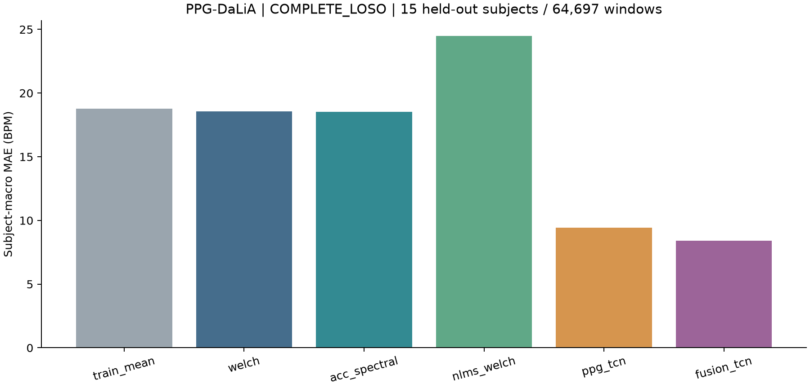
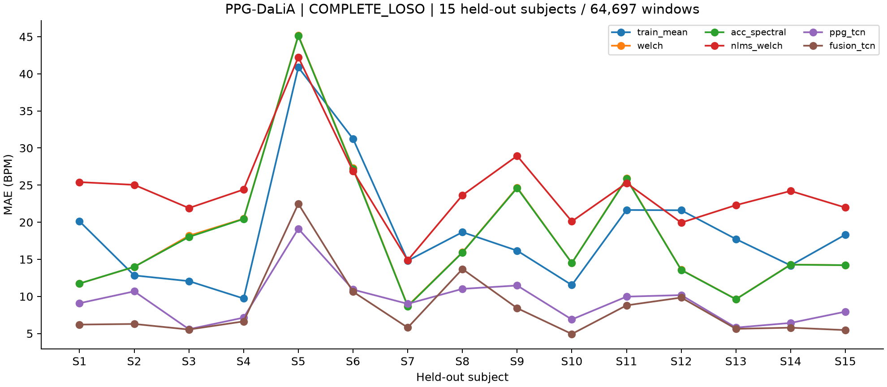
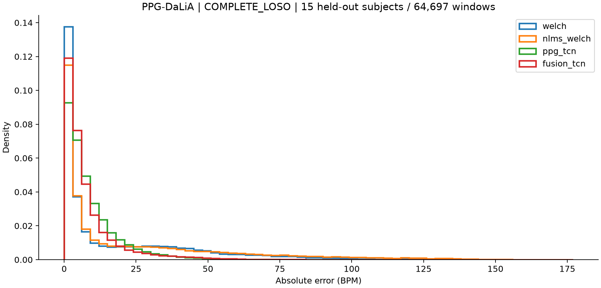
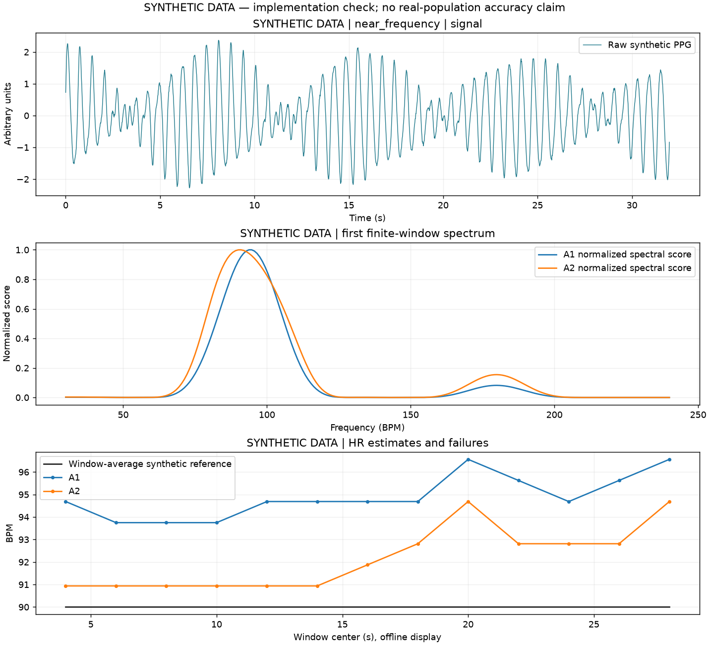

# Motion-Robust-PPG-Heart-Rate

Motion-aware heart-rate estimation from wrist PPG and three-axis accelerometry: SciPy signal processing, adaptive filtering, PyTorch TCNs, subject-isolated evaluation and ONNX CPU inference.

[中文说明](README_CN.md) · [Engineering scope](docs/showcase_spec.md) · [Experiment report](docs/showcase_results.md) · [Aggregate metrics](docs/showcase_metrics.json)

## Project Overview

An algorithm-engineering portfolio for interviews and practical demonstrations. The project independently implements traditional signal-processing methods, a PPG-only TCN and a PPG+ACC two-branch TCN. It is not an exact reproduction of Deep PPG, KID-PPG or BeliefPPG, and does not claim clinical accuracy.

Implemented: data adaptation, fixed windows, Welch/ACC-assisted spectrum/NLMS baselines, two TCNs, subject-level splits, activity/subject metrics, real-data charts, synthetic demo and local ONNX checks. **Complete fixed-config LOSO: 15 held-out subjects, 64,697 / 64,697 official-label windows.**

## Dataset

[PPG-DaLiA](https://archive.ics.uci.edu/dataset/495/ppg%2Bdalia) includes 15 subjects: wrist BVP at 64 Hz, three-axis ACC at 32 Hz and ECG-derived reference HR. Cite the dataset (DOI [10.24432/C53890](https://doi.org/10.24432/C53890)) and Reiss et al., *Deep PPG*, Sensors 2019 (DOI [10.3390/s19143079](https://doi.org/10.3390/s19143079)).

All **64,697 official HR labels** are retained. The engineering mapping uses `[2k, 2k+8)` seconds from the synchronized start: PPG `[128k,128k+512)`, ACC `[64k,64k+256)`, label index `k`. Complete terminal windows are included; partial trailing windows are not padded. File hashes, subject identity, durations, window counts, finite inputs and explicit time metadata are checked. Mismatches stop preparation; no minimum-length truncation or offset search is allowed.

The mapping is supported by synchronized-data documentation, consistent counts and a separately recorded numerical reference audit. Original generator/version and duplicate-annotation history are Deferred, not prerequisites for this engineering benchmark. Labels are never replaced by reconstructed ECG targets; all historical audits and anomalies remain preserved locally. Raw acquisition timestamps are absent, so every possible packet-loss or alignment issue cannot be ruled out.

## Signal Processing Methods

Offline preprocessing uses fourth-order Butterworth 0.5-4 Hz zero-phase filtering, separately per subject at native rates. Every method uses the same windows and original reference labels.

| Method | Implementation |
|---|---|
| Welch | PPG PSD peak in 30-240 BPM; Hann, 4 s segments, 50% overlap, 4096-point FFT at 64 Hz |
| ACC-assisted spectrum | Motion-associated peaks downweighted on the shared PPG/ACC physical frequency grid |
| NLMS + Welch | Three-axis ACC zero-order held to 64 Hz; 8 taps per axis, step 0.05; residual passed to Welch |
| Train mean | Sanity baseline fitted to training labels only |

NLMS runs continuously and resets per subject; overlapping windows never repeatedly update the same sample. ACC is not a clean noise reference. Shared motion/pulse frequencies can cause cancellation of useful pulse content. Failure results are retained without test-driven retuning.

## Deep Learning Models

Residual temporal convolutions use channels `[16,32,64]`, kernel 5, dilations `[1,2,4]`, dropout 0.1 and global average pooling. Padding is symmetric: these are **offline**, noncausal models.

| Model | Preprocessed input | Parameters |
|---|---|---:|
| PPG-only TCN | `[B,1,512]` | 42,737 |
| PPG+ACC two-branch TCN | `[B,1,512]` + `[B,3,256]` | 89,697 |

PPG is standardized per window. ACC is demeaned per window and divided by a common RMS fitted from unique continuous training records only. HR target mean/std also use training labels only; target rescaling is embedded in the exported model. ECG, R peaks, HR labels and activity labels never enter the prediction interface.

## Experimental Setup

The [fixed configuration](configs/showcase.yaml) uses seed 42, AdamW, learning rate 0.001, weight decay 0.0001, batch 256 and 12 epochs, with normalized-target MSE. Validation-window MAE selects the checkpoint; there is no hyperparameter search or test-set tuning.

[Subject splits](splits/loso_v1.json) provide 15 folds, each 12 train / 2 validation / 1 test. First: S1 test, S2/S3 validation, S4-S15 train. The remaining folds keep the identical settings. No random-window splitting, final 14-subject refit or nested search is performed. The public data had already been inspected during engineering/reference audits; this is a development benchmark, not an untouched external cohort.

Local artifacts record source/config/split/cache/dependency hashes, epoch histories, checkpoints, complete predictions and grouped metrics. Aggregation checks every test subject/index and original label against the verified cache, rejecting incompatible data/splits/locks/configs or missing/duplicate IDs. Metrics include MAE, RMSE, bias, tail error, coverage and activity/subject groups.

## Results

**Complete fixed-config LOSO: 15 held-out subjects, 64,697 / 64,697 official-label windows.** All errors below are in BPM; all completed test windows are included.

| Method | Subject-macro MAE | Window-micro MAE | Window-micro RMSE | Coverage |
|---|---:|---:|---:|---:|
| Train mean | 18.770 | 18.390 | 23.713 | 100% |
| Welch | 18.562 | 18.383 | 30.378 | 100% |
| ACC-assisted spectrum | 18.515 | 18.337 | 30.347 | 100% |
| NLMS + Welch | 24.479 | 24.421 | 40.012 | 100% |
| PPG-only TCN | 9.419 | 9.346 | 13.696 | 100% |
| PPG+ACC TCN | 8.413 | 8.316 | 13.605 | 100% |

The fusion model has more parameters, so the comparison does not isolate the causal benefit of ACC. NLMS failure is retained. These are measured engineering results, not published-paper reproduction scores.

## Visualizations





These real-data figures contain aggregate errors only. Per-window predictions, real signal traces and caches remain local. Synthetic demo plots are clearly marked `SYNTHETIC DATA` and do not establish real-population accuracy.



The synthetic figure illustrates PPG/ACC spectral reasoning on generated signals. It is separate from the real-data results above.

## Installation and Quick Start

Python 3.11 and uv are required. Dependencies stay in the project `.venv`. The optional ML group pins PyTorch 2.9.1 with official CUDA 12.8 wheels on Windows/Linux; system Python/drivers are not modified.

```powershell
uv sync --locked --default-index https://pypi.org/simple
uv run --locked --offline --default-index https://pypi.org/simple ppg-hr doctor
uv run --locked --offline --default-index https://pypi.org/simple ppg-hr demo --synthetic --config configs/demo.yaml --spectral-config configs/baselines/welch.yaml

uv sync --locked --extra ml --default-index https://pypi.org/simple
uv run --locked --offline --default-index https://pypi.org/simple --extra ml python scripts/register_dataset.py --archive "<official-PPG_FieldStudy.zip>" --destination "<new-external-data-root>" --trust-official-archive
uv run --locked --offline --default-index https://pypi.org/simple --extra ml python scripts/prepare_showcase.py --data-root <extracted-data-root> --trust-local-pickle
uv run --locked --offline --default-index https://pypi.org/simple --extra ml python scripts/run_showcase.py --cache <cache-directory> --folds 0 --device cuda
uv run --locked --offline --default-index https://pypi.org/simple --extra ml python scripts/run_showcase.py --cache <cache-directory> --folds 1 2 3 4 5 6 7 8 9 10 11 12 13 14 --device cuda
uv run --locked --offline --default-index https://pypi.org/simple --extra ml python scripts/summarize_showcase.py --runs <first-run> <remaining-run> --cache <cache-directory>
```

Replace angle-bracket placeholders with local paths before running. Download the original `PPG_FieldStudy.zip` yourself from the [author dataset page](https://ubi29.informatik.uni-siegen.de/usi/data_ppgdalia.html), then run `register_dataset.py` to verify the pinned 2,864,337,783-byte release, extract without overwriting and create `.acquisition-status.json`. The archive and extraction directory must both stay outside the repository; extraction requires about 24.2 GB plus reserve. The script does not download data. A different archive release requires a new audit, not a bypass. If the audited extraction already exists, skip registration and reuse that data root.

The extracted root contains the receipt and `PPG_FieldStudy/S1/S1.pkl` through S15. Only use trusted official pickle files; the flag acknowledges trust and does not make unknown pickle safe. CPU training is supported via `--device cpu`, with no CPU training-runtime claim. Training/aggregation require real data and are not part of the no-data smoke demo.

The original `audit-data` / `prepare` commands retain the historical strict audit. Use `scripts/prepare_showcase.py` for the explicitly versioned engineering path; do not toggle the old official-certification booleans.

Two frozen historical diagnostic protocols are included to keep the retained audit tools and synthetic tests self-contained. They are archival records; the current development scope is [showcase_v1](docs/showcase_spec.md), with author-side generator history Deferred.

## ONNX Inference

Both first-fold checkpoints have FP32 ONNX exports with dynamic batch size, graph validation and CPU parity checks at batches 1 and 7. Maximum absolute differences: `7.63e-06` BPM (PPG), `1.53e-05` BPM (fusion), tolerance `1e-4`.

```powershell
uv run --locked --offline --default-index https://pypi.org/simple --extra ml python scripts/infer_onnx.py --model <local-fold-directory>/fusion_tcn.onnx --synthetic-smoke
uv run --locked --offline --default-index https://pypi.org/simple --extra ml python scripts/infer_onnx.py --model <local-fold-directory>/fusion_tcn.onnx --inputs <normalized-windows.npz>
```

Inputs are already filtered/normalized PPG/ACC windows, not raw signals. The per-model metadata saves training normalization. Local model-only CPU median latency: 0.259 ms / 0.338 ms, batch 1, 10 warmups and 100 repeats, default ONNX Runtime threading on the development machine. This excludes preprocessing and acquisition/window collection and is not wearable end-to-end latency. Checkpoints and ONNX weights remain local.

No trained model is included in the showcase package. Train locally to obtain the exported files before running either ONNX command. `--synthetic-smoke` uses random signal-only inputs to check execution; its output is not an accuracy measurement. Without data or weights, the earlier synthetic spectral demo remains runnable.

## Tests and Project Structure

```powershell
uv run --locked --offline --default-index https://pypi.org/simple --extra ml pytest -q --basetemp=runs/test-local
uv run --locked --offline --default-index https://pypi.org/simple --extra ml ruff check src scripts tests
```

```text
src/ppg_hr/  # data contracts, preprocessing, baselines, TCNs, experiments
configs/     # fixed processing and experiment settings
splits/      # subject-level roles and hashes
scripts/     # preparation, training, aggregation, ONNX inference
tests/       # synthetic-only fixtures and regression checks
docs/        # scope, aggregate results, sources and historical evidence
cache/ runs/ # ignored local records, models and logs
```

## Limitations

- One dataset, one seed and a compact 12-epoch budget; no clinical or independent external validation.
- Fusion has more parameters; no capacity-matched or ACC-only attribution experiment is claimed.
- Offline filtering and TCN padding use future samples; causal streaming, MCU and smartwatch validation are Deferred.
- ACC and pulse spectra can overlap. Adaptive cancellation and motion suppression may worsen HR estimation.
- Author-side generator provenance remains unknown. All official labels and anomaly records are preserved.
- UCI and author pages have different licensing statements. Raw data and participant-derived records are not redistributed; see [data policy](docs/data_policy.md).
- Original code is licensed under MIT (see `LICENSE` and `THIRD_PARTY_NOTICES.md`); dataset and dependency licenses remain separate. Publication uses a separate whitelist; raw data, caches, checkpoints/weights, full logs, personal information and per-window predictions are excluded.
